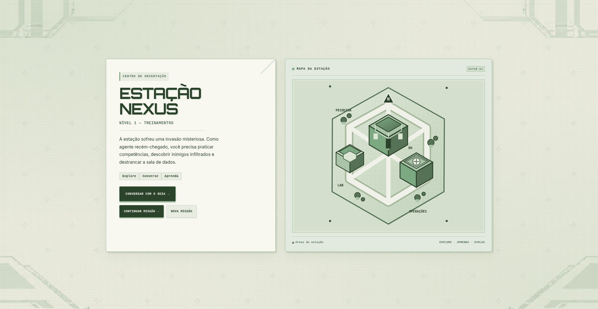

# NexusGame



Jogo educativo em pixel art para treinamentos e processos seletivos gamificados.

## Tecnologias

- HTML5 para a estrutura das telas.
- CSS3 dividido por responsabilidade visual.
- JavaScript nativo para o jogo, o canvas, os diálogos e o progresso.
- `localStorage` para salvar a partida no navegador.
- Canvas 2D e sprites em pixel art para os cenários e personagens.

Não há servidor de aplicação, banco de dados ou dependências de runtime. O jogo é publicado como site estático.

## Executar localmente

Requisitos: Python 3 e Node.js 20 ou superior (Node é necessário apenas para validar o código).

```bash
# Dentro da pasta NexusGame
python3 -m http.server 4173
```

Abra `http://localhost:4173`. Servir por HTTP local é preferível a abrir o HTML diretamente como `file://`, pois aproxima os caminhos e permissões do ambiente publicado.

## Verificações

Antes de enviar alterações, execute `npm run check` para validar a sintaxe do JavaScript e os testes de integridade.

```bash
npm run check:js  # verifica sintaxe JavaScript
npm test          # verifica estrutura e recursos locais
npm run check     # executa as duas verificações
```

## Estrutura do projeto

```text
NexusGame/
├── index.html              # entrada principal do jogo
├── NexusGame.html          # atalho legado para index.html
├── css/                    # estrutura base e identidade visual
├── js/jogo.js              # lógica do jogo e das fases
├── assets/                 # fundos, sprites e personagens usados em runtime
├── docs/                   # arquitetura e créditos dos recursos
├── tests/                  # verificações automatizadas sem dependências extras
├── package.json            # comandos de verificação e servidor local
└── AGENTS.md               # instruções de manutenção para pessoas e agentes de IA
```

## Salvamento local

O jogo salva o progresso em `localStorage` usando a chave `nexus_estado_completo_v3`. Essa chave foi mantida durante a organização para preservar os saves existentes no mesmo navegador e origem. Um endereço publicado no Vercel tem uma origem diferente de `file://` ou `localhost`; o salvamento local não é transferido automaticamente para o domínio publicado. Limpar os dados do site no navegador também apaga o progresso salvo.

## Publicação no Vercel

Veja [docs/EXECUCAO-E-DEPLOY.md](docs/EXECUCAO-E-DEPLOY.md). O projeto é estático: não é necessário instalar dependências nem executar build.

## Créditos

Os sprites de terceiros usados pelo jogo e as informações de atribuição estão documentados em [docs/CREDITOS.md](docs/CREDITOS.md).
